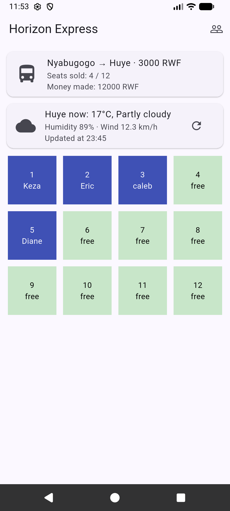
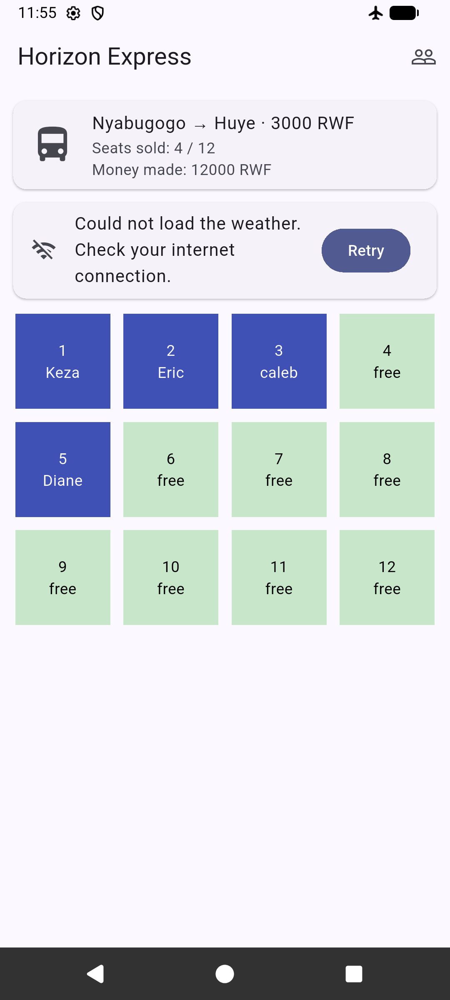

# horizon booking
A bus booking app. 

My data is now saved on the phone with shared_preferences,
so nothing is lost when the app closes,
and it shows weather information from open-meteo weather api 

"https://api.open-meteo.com/v1/forecast?latitude=-2.5967&longitude=29.7394&current=temperature_2m,relative_humidity_2m,wind_speed_10m,weather_code&timezone=Africa%2FKigali". 

## Screenshots 

 

 

 

